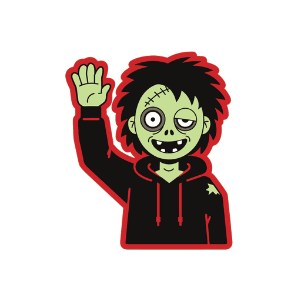

# Zombye

<p align="center">
  
</p>

**Open-source zombie survival in real 3D.** Isometric, with hundreds of zombies on screen, built in
Rust so that anyone (and any AI agent) can read it, mod it and host it.

> **Status: pre-alpha.** M0 (tech spike) and M1 (world and visibility) are done; M2 (player and
> combat) is in progress. Not a full game yet. The roadmap lives on the
> [Game development board](https://github.com/orgs/deadcommons/projects/2) and the
> [milestones](https://github.com/deadcommons/zombye/milestones); the design is in
> [docs/PLAN.md](docs/PLAN.md).

## What it is

- **Classic slow-burn survival:** wake up in a house in a small town, scavenge, sneak or fight,
  patch your wounds and see how long you last. [VISION.md](VISION.md) explains what we keep and
  what we change.
- **Real 3D**, viewed from a fixed isometric camera, with an optional 4-angle snap.
- **Fast:** thousands of zombies simulated, hundreds on screen, and a headless deterministic sim.
- **Moddable by default:** every gameplay value lives in a data file, and servers push mods to
  players.
- **Agent-first:** the server has a built-in MCP endpoint, so AI agents can play, test, administer
  and build mods.
- **Host it anywhere:** self-hosting is free and documented. Official one-click hosting by
  Dead Commons is coming, and it pays for development.

## Build and run

Needs a current stable Rust toolchain.

```bash
cargo run --release --bin zombye
```

The M0 spike is a test town and a 1,000+ zombie horde that chases you. WASD to move, Shift to run,
mouse wheel to zoom, Z to spawn 250 more zombies. Options: `--zombies N`, `--seed S`, `--rotate`
(four-angle camera on Q/E), `--novsync`, `--screenshot PATH`, `--exit-after SECS`. The client prints
fps and sim timing once a second.

The headless server (benchmark mode, or MCP over stdio for agents):

```bash
cargo run --release --bin zombye-server -- --bench --zombies 1000
```

```bash
cargo run --release --bin zombye-server -- --mcp
```

Agents can connect through [.mcp.json](.mcp.json) (build the server first). See [AGENTS.md](AGENTS.md)
for the tools and repo rules.

## Contributing

Contributions from people and their agents are welcome. Read [CONTRIBUTING.md](CONTRIBUTING.md)
first, especially the **clean-room rules**, and follow the [code of conduct](CODE_OF_CONDUCT.md).

Come and talk to us on **[Discord](https://discord.gg/y7NsmVG2br)**: follow the devlog, share
ideas, or find people to mod and build with.

## License

Zombye's code (the game, the server, tools, data, shaders and docs) is dual-licensed under
[MIT](LICENSE-MIT) or [Apache-2.0](LICENSE-APACHE), at your option. Our art and audio (models,
textures, animations, images, sounds and music) are licensed under
[CC BY-NC-SA 4.0](assets/LICENSE): use them in mods, fan work and non-commercial projects;
commercial use needs our permission.

**Videos and streams:** you're welcome to record, stream and monetise videos and screenshots of
Zombye without asking.

Copyright (c) 2026 Dead Commons and the Zombye contributors. Required notices are in
[NOTICE](NOTICE), and every asset is listed in [ATTRIBUTION.md](ATTRIBUTION.md). The Zombye and Dead Commons
names and logos are trademarks; see [docs/brand/LICENSE-brand.txt](docs/brand/LICENSE-brand.txt).
