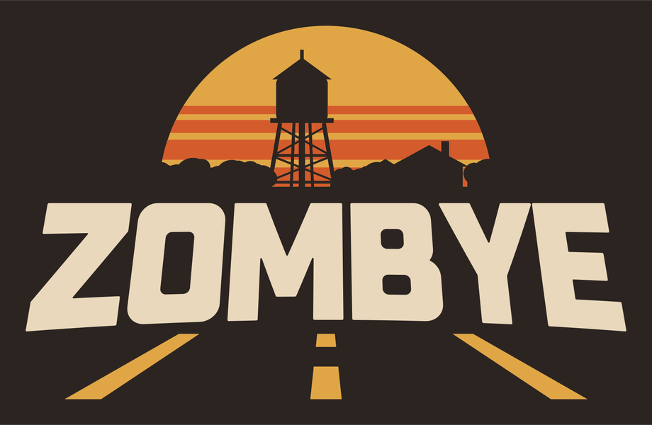
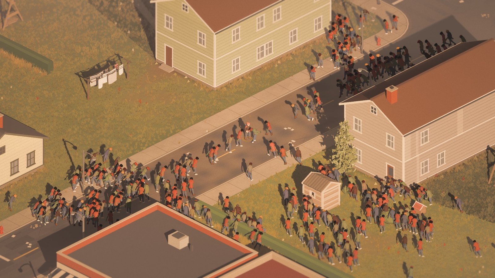
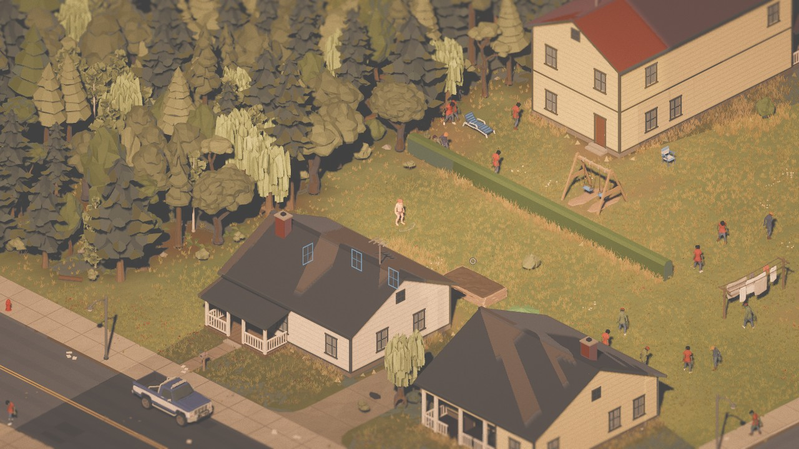
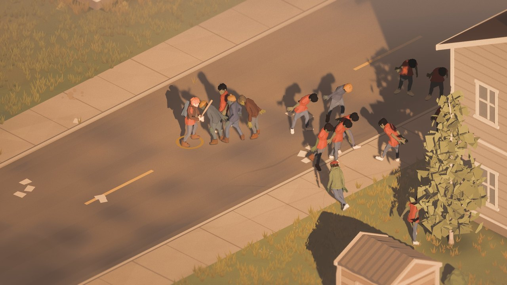
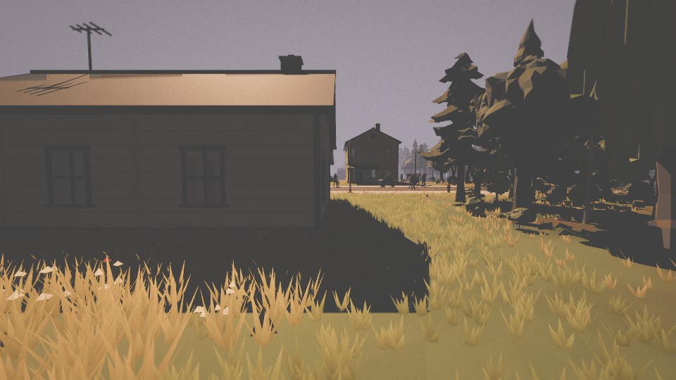
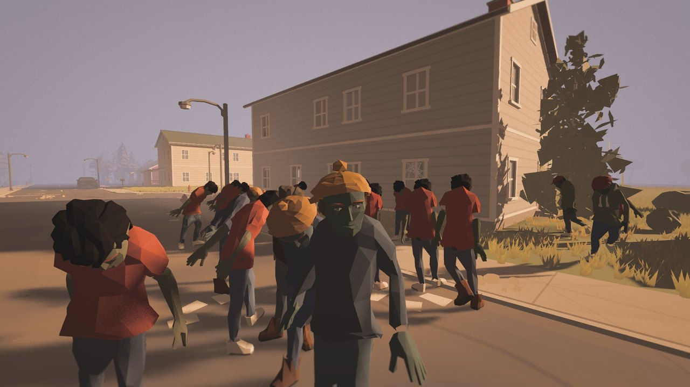
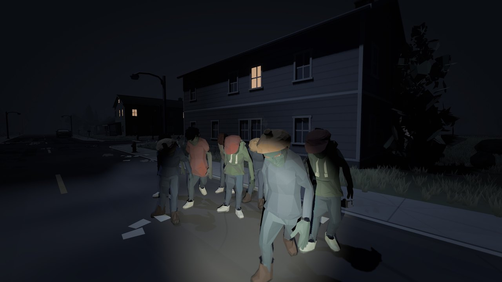
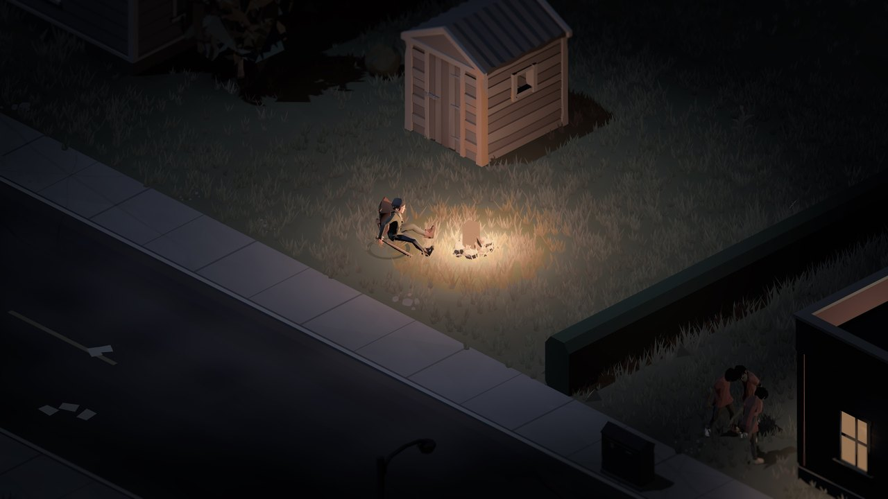
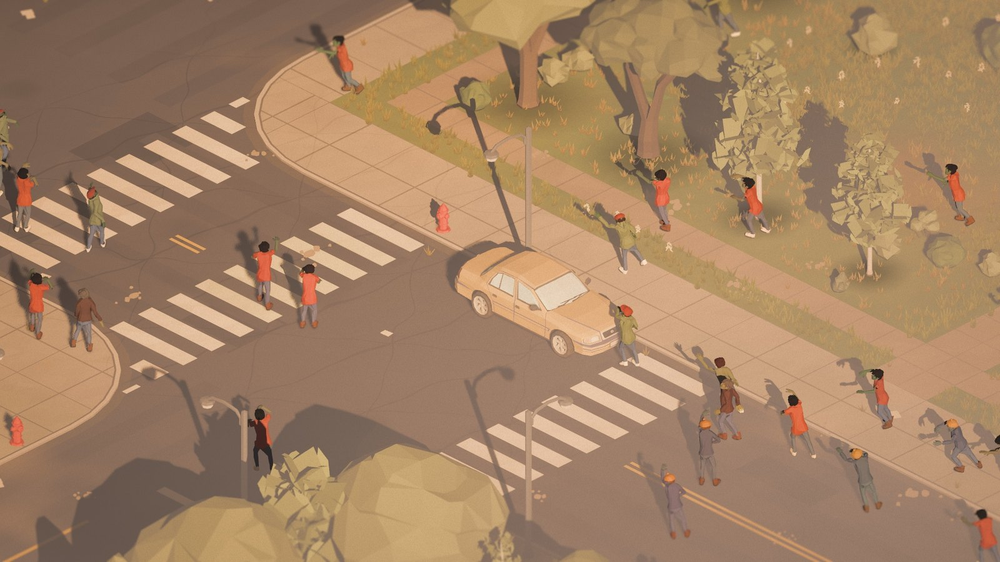
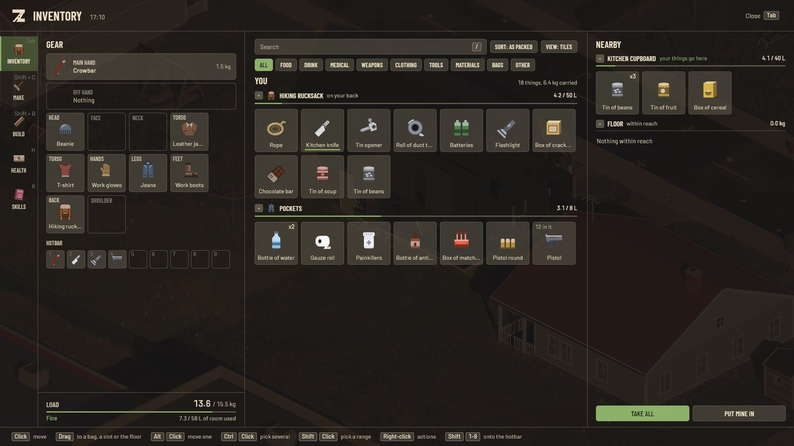

<p align="center">
  <a href="https://getzombye.com"></a>
</p>

<h1 align="center">ZOMBYE™</h1>

<p align="center">
  <b>Zombie survival in real 3D, with a whole town of the dead on your trail.</b><br>
  Open source, made in Rust, built for players, modders and AI agents.
</p>

<p align="center">
  
  
  
  
  <a href="https://discord.gg/y7NsmVG2br"></a>
</p>

<p align="center">
  <a href="docs/readme/horde.jpg"></a>
</p>

<p align="center">
  <a href="#why-zombye">Why Zombye</a> ·
  <a href="#a-look-around">Screenshots</a> ·
  <a href="#whats-in-the-game">What's in the game</a> ·
  <a href="#play-it">Play it</a> ·
  <a href="#built-for-agents">Agents</a> ·
  <a href="#mod-it">Mods</a> ·
  <a href="#host-a-server">Host a server</a> ·
  <a href="#come-and-build-it-with-us">Contribute</a>
</p>

You wake up in a bedroom in a small town. The street outside is quiet, for now. Search the houses,
keep the noise down, patch your wounds, and see how long you last. Every door you break and every
window you smash is heard by something, and the town holds thousands of them.

Zombye is a free-standing game, not a mod of anything, and the whole thing is about 300 MB.

> [!NOTE]
> **Pre-alpha, in playtesting.** Single-player and multiplayer both run, and plenty is still missing.
> Come and follow along, or ask for a playtest build, on **[Discord](https://discord.gg/y7NsmVG2br)**.

## Why Zombye

#### 🧟 A horde that is really there

Up to 20,000 zombies live in the world at once, each one simulated: they see, hear, remember and
wander off on their own. Make a loud noise on one side of town and the far side starts walking.

#### ⚡ Fast

Made in Rust. A thousand zombies chasing you while twenty thousand more roam the map costs about a
millisecond of server time per tick. Hundreds on screen stay smooth on ordinary hardware.

#### 🎥 3D first

A real 3D world, not sprites. Play from above with the classic isometric camera, or drop into
first person and walk the same streets at eye level.

#### 🤖 Agent-first

The server speaks [MCP](https://modelcontextprotocol.io). An AI agent can look at the world, play
a survivor, run a server or build and test a mod, with the same rules as a human player.

#### 🧰 Moddable to the bone

Every item, weapon, recipe, loot table, building and tuning number is a plain data file. Behaviour
is added with sandboxed Luau scripts, and servers send their mods to the players who join.

#### 💻 Runs anywhere

Linux, Windows and macOS. The server is one headless binary or a Docker image, and hosting your own
is free.

## A look around

<table>
  <tr>
    <td width="50%" valign="top">
      <a href="docs/readme/town.jpg"></a>
      <br><b>A town that is generated, not painted.</b> Streets, yards, shops and the woods beyond,
      different for every seed.
    </td>
    <td width="50%" valign="top">
      <a href="docs/readme/fight.jpg"></a>
      <br><b>Swing, shove, stomp.</b> Three in reach, and more coming up the street.
    </td>
  </tr>
  <tr>
    <td width="50%" valign="top">
      <a href="docs/readme/first-person.jpg"></a>
      <br><b>Eye level.</b> The same world in first person, and the same crowd.
    </td>
    <td width="50%" valign="top">
      <a href="docs/readme/face-to-face.jpg"></a>
      <br><b>Too close.</b> Every one of them is simulated: it saw you, or it heard you.
    </td>
  </tr>
  <tr>
    <td width="50%" valign="top">
      <a href="docs/readme/night.jpg"></a>
      <br><b>Night is dark.</b> You see what your flashlight shows you, and not much else.
    </td>
    <td width="50%" valign="top">
      <a href="docs/readme/campfire.jpg"></a>
      <br><b>A fire is warmth, a hot meal and a beacon.</b> Something by the window has noticed.
    </td>
  </tr>
</table>

<p align="center">
  <a href="docs/readme/drive.jpg"></a>
  <br><i>The parked cars start, if they have fuel. The engine is heard a long way off.</i>
</p>

<p align="center">
  <a href="docs/readme/inventory.jpg"></a>
  <br><i>Everything you carry has weight and takes up room. Choose what comes with you.</i>
</p>

## What's in the game

- **Scavenging.** Search furniture room by room: fridges, wardrobes, toolboxes, shop shelves. Food
  goes stale, then mouldy.
- **Fighting.** Bats, knives, axes, fists and guns. Shove a zombie back, knock it down, stomp it.
  Swings cost stamina, and weapons wear out.
- **Wounds that matter.** Scratches, gashes and bites on ten body parts. Bandage, disinfect and
  stitch them, or bleed. A bite may be the end of you, and you won't know for hours.
- **Staying alive.** Hunger, thirst, tiredness and sleep. Light a campfire, cook, and barricade the
  windows before dark.
- **Zombies with senses.** They see by daylight, hear through walls, batter doors down as a crowd,
  and climb in through the window you broke.
- **Skills by doing.** Nine skills that only improve with practice.
- **A living world.** Day and night, weather and seasons, hills and forest round the town, power
  that can fail, and cars you can drive.
- **Multiplayer.** Dedicated servers with proximity chat, groups, and hold-ups if your friends are
  that sort of friends.
- **Saves you can trust.** The simulation is deterministic: a loaded world carries on exactly as
  the saved one would have.

The design, and what we keep and change from the classics of the genre, is in
[VISION.md](VISION.md) and [docs/PLAN.md](docs/PLAN.md).

## Play it

**From source.** You need a current stable Rust toolchain.

```bash
cargo run --release --bin zombye
```

It opens on the main menu. WASD to move, Shift to run, right mouse to aim and left to swing, E to
pick up or search, Tab for the inventory, mouse wheel to zoom, `,` and `.` to turn the camera. Esc
opens the pause menu, and its Controls tab lists every key. Options such as `--zombies N` and
`--seed S` start a world straight away; [AGENTS.md](AGENTS.md) lists them all.

**The official build.** Everything in this repo is open, and building it gives you the whole game:
every system, the server, the MCP tools and mods, with its own models, placeholder sounds and the
name as plain text. The official build from Dead Commons adds art and audio bought under licences
that don't allow publishing the files (the screenshots above show it), plus signed installers,
updates and official servers. Buying it is how you pay for the game's development; building it
yourself is always free.

## Built for agents

The headless server is also an MCP server. Point any MCP client at it and the agent gets tools to
observe the map, move, fight, loot, craft, treat wounds, take screenshots and step time.

```bash
cargo build --release --bin zombye-server --bin zombye
cargo run --release --bin zombye-server -- --mcp
```

[.mcp.json](.mcp.json) registers it for MCP clients that read one. [AGENTS.md](AGENTS.md) describes
every tool and the rules of the repo.

To compare agents, the **survival benchmark** plays fixed scenarios over MCP and writes each run's
score to a file ([docs/benchmark.md](docs/benchmark.md)):

```bash
cargo run --release --bin zombye-server -- --benchmark list
cargo run --release --bin zombye-server -- --mcp --benchmark first_night --agent my-agent
```

Want to see the simulation hold a horde? This runs a 1 km map with 21,500 zombies and prints the
cost per tick:

```bash
cargo run --release --bin zombye-server -- --bench --ticks 400 --map-chunks 64 --zombies 21500 --players 1 --horde 1000
```

## Mod it

A mod is a folder: data files that add or change items, weapons, recipes, loot, buildings and
sounds, and Luau scripts for new behaviour. Scripts are sandboxed and deterministic, so a modded
server stays in step with its players. [mods/alarm_clock](mods/alarm_clock) is a small working
example: an alarm clock you wind up and leave behind as a lure.

Start with [docs/modding.md](docs/modding.md), or the step-by-step guides on the
[docs site](https://getzombye.com/docs/modding/).

## Host a server

Multiplayer runs on a dedicated server anyone can host, for free: one binary and one config file,
or a Docker image you build from this repo. See [docs/self-hosting.md](docs/self-hosting.md).

```bash
docker build -t zombye-server .
docker run -d -p 7777:7777 -v zombye-data:/data zombye-server
cargo run --release --bin zombye -- --connect localhost        # join it
```

## Docs

| | |
|---|---|
| **Playing** | [getzombye.com/docs](https://getzombye.com/docs/): installing, controls, your first night |
| **Modding** | [docs/modding.md](docs/modding.md) and the [modding guides](https://getzombye.com/docs/modding/) |
| **Agents** | [AGENTS.md](AGENTS.md), [docs/benchmark.md](docs/benchmark.md) |
| **Hosting** | [docs/self-hosting.md](docs/self-hosting.md) |
| **Design** | [VISION.md](VISION.md), [docs/PLAN.md](docs/PLAN.md), [docs/art-direction.md](docs/art-direction.md) |
| **Roadmap** | the [Game development board](https://github.com/orgs/deadcommons/projects/3) and the [milestones](https://github.com/deadcommons/zombye/milestones) |

## Come and build it with us

Contributions from people and their agents are welcome: code, data, mods, bug reports, ideas.

- Read [CONTRIBUTING.md](CONTRIBUTING.md) first, especially the **clean-room rules**, and follow
  the [code of conduct](CODE_OF_CONDUCT.md).
- Sign off every commit (`git commit -s`). That's the [DCO](https://developercertificate.org/), and
  there's no CLA.
- Using AI to help? Good, so do we. [AI.md](AI.md) says how: you answer for what you send, and you
  say when a tool did a real part of the work.

Come and talk to us on **[Discord](https://discord.gg/y7NsmVG2br)**: follow the devlog, share
ideas, or find people to mod and build with.

## License

Zombye's code (the game, the server, tools, data, shaders and docs) is dual-licensed under
[MIT](LICENSE-MIT) or [Apache-2.0](LICENSE-APACHE), at your option. Our art and audio (models,
textures, animations, images, sounds and music) are licensed under
[CC BY-NC-SA 4.0](assets/LICENSE): use them in mods, fan work and non-commercial projects;
commercial use needs our permission.

**Videos and streams:** you're welcome to record, stream and monetise videos and screenshots of
Zombye without asking.

**The name and the logo are not open source.** ZOMBYE™ and Dead Commons, their wordmarks and logos,
the logo at the top of this page included, are trademarks of Grillo Ltd and all rights are
reserved. They are not covered by any of the licences above: a fork you publish takes its own name
and its own logo. See [docs/brand](docs/brand/README.md) and
[docs/brand/LICENSE-brand.txt](docs/brand/LICENSE-brand.txt). The screenshots in
[docs/readme](docs/readme/README.md) show the official build and are not open source either.

Copyright (c) 2026 Grillo Ltd (trading as Dead Commons) and the Zombye contributors. Required
notices are in [NOTICE](NOTICE), and every asset is listed in [ATTRIBUTION.md](ATTRIBUTION.md).
